  

## About Me
B.Tech AI Engineering student at **G H Raisoni College of Engineering, Nagpur** (CGPA 8.33, 2027). I build and ship LLM, retrieval-based and computer-vision systems, from model training to Dockerized deployment.
Interned at **Infosys Springboard** and **IBM SkillBuild**.

## Featured Projects
| [**SafetyEye**: PPE Detection](https://github.com/springboardmentor425/B-13-SafetyEye-AI-Powered-Workplace-Occupancy-Safety-Monitor) | [**RESPIRA**: Chest X-Ray AI](https://github.com/RushikeshTelrandhe/RESPIRA-AI-Assisted-Chest-X-Ray-Analysis) |
|:---:|:---:|
| Real-time PPE compliance with YOLOv8. **91.4% mAP@0.5**, 28+ FPS. ONNX + FastAPI + PostgreSQL + Grafana + Docker. | EfficientNet-B0 + ViT hybrid, 6-class diagnosis. **0.9643 macro ROC-AUC**, Grad-CAM explainability. |
| [**Career Path Advisor**](https://github.com/RushikeshTelrandhe/Career_Path_Advisor) | [**BlueCarbon MRV**](https://github.com/RushikeshTelrandhe/BlueCarbon_MVR_System) |
| Résumé parsing, SBERT role matching, skill-gap analysis. Streamlit. | Blockchain carbon credits (Solidity, Web3.py) + ML forecasting. |

<h2>Tech Stack</h2>

### 🧠 Machine Learning & Vision
<table><tr align="center">
<td> Python</td>
<td> PyTorch</td>
<td> TensorFlow</td>
<td> Scikit-learn</td>
<td> OpenCV</td>
<td> Pandas</td>
<td> NumPy</td>
</tr></table>

### ⚙️ Backend & Deployment
<table><tr align="center">
<td> FastAPI</td>
<td> Flask</td>
<td> PostgreSQL</td>
<td> SQLite</td>
<td> Docker</td>
<td> CI/CD</td>
<td> Grafana</td>
</tr></table>

### 🔗  Languages & Tools
<table><tr align="center">
<td> C</td>
<td> C++</td>
<td> Git</td>
<td> GitHub</td>
<td> VS Code</td>
</tr></table>

## 📊 GitHub Activity

  
  

  

<b>💡 Learn · Build · Solve · Impact</b>

  

<h2>Let's Connect</h2>

  
  
  

